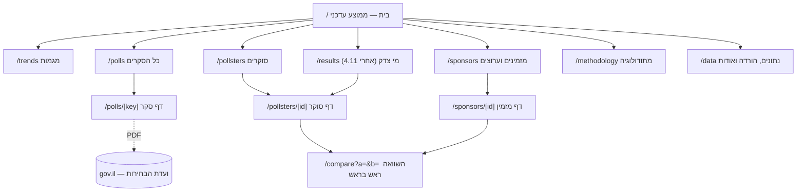

# תוכנית חזית — skrim

> 20.10.2026 · מבוסס על [`docs/research/RESEARCH.md`](../research/RESEARCH.md). הפניות כמו «R7.3» מצביעות על ההחלטה במקום 3 בסעיף 7 שם; הפניות כמו «R5.4» מצביעות על ממצא בסעיף 5.4.
> זו תוכנית בלבד, בלי קוד ייצור. היא מתווה שינויים בתוך `site/` הקיים.

## 0. האם המחקר תומך בגישה של האפיון?

**כן, עם חמש סטיות.** אתר סטטי ב-Astro עם Observable Plot הוא הבחירה הנכונה. Plot כבר מותקן, מייצר SVG עם טקסט אמיתי ו-ARIA, ומשקלו כ-90KB gzip. זה תואם למדידה חיצונית (R5.8). האתר הקיים כבר עושה כמה דברים נכון:

- נקודות מאחורי קו ממוצע
- רצועה שמוסברת כפיזור ולא כרווח בטחון
- קו 61
- תוויות ישירות
- טבלה חלופית
- קישור ל-PDF

אלה הדפוסים שחוזרים אצל האתרים הטובים (R4). לכן לא בונים מחדש: **מחזקים ומשלימים**.

הסטיות מהאפיון ומה-MVP:

1. **בלי Tailwind.** האפיון מציין Astro + Tailwind, אבל האתר נבנה בלי Tailwind. מוסיפים קובץ טוקנים ב-CSS רגיל, כי זה פחות תלות, ושליטה מלאה ב-RTL דרך logical properties.
2. **צבעי הגושים מוחלפים.** הכחול והכתום הנוכחיים אינם ניטרליים, והירוק נכשל בניגודיות (R5.5, R7.3).
3. **בלי חצי-עיגול מליאה**, אף שהוא נפוץ. במקומו פס 120 יחיד עם קו 61 (R6).
4. **«מי צדק» מוצג כמחקר רשום מראש.** הנוסחה ננעלת לפני 27.10, והדף מציג את ה-commit שלה (R7.8).
5. **העלייה לאוויר.** לפי CLAUDE.md אין פרסום לציבור לפני סגירת הקלפיות. לכן ה-MVP צריך להיות **מוכן** עד 27.10, ו**לעלות** ב-27.10 בשעה 22:00 או אחריה. ראו שאלה פתוחה 1.

---

## 1. ארכיטקטורת מידע ומפת אתר



| מסלול | קיים? | שלב |
| --- | --- | --- |
| `/` | ✔ `pages/index.astro` | עיבוד מחדש — MVP |
| `/trends` | ✔ `pages/trends.astro` | עיבוד — MVP |
| `/polls` | ✔ `pages/polls/index.astro` | עיבוד — MVP |
| `/polls/[key]` | ✔ `pages/polls/[key].astro` | עיבוד — MVP |
| `/pollsters` | ✔ `pages/pollsters.astro` | עיבוד — MVP. הדף עובר ל-`pages/pollsters/index.astro` |
| `/pollsters/[id]` | ✘ | חדש — שלב ב' (עד 4.11) |
| `/sponsors`, `/sponsors/[id]` | ✘ | חדש — שלב ב' |
| `/compare` | ✘ | חדש — שלב ב'. נבנה סטטית לכל זוג סוקרים פעילים, או בבחירה בצד הלקוח מתוך JSON. ראו 7.4 |
| `/results` | ✘ | שלד במצב «ממתין לתוצאות» — שלב ב'; תוכן — שלב ג' |
| `/methodology` | ✔ | עיבוד — MVP |
| `/data` | ✘ | חדש — MVP: הורדות + אודות + דיווח טעות |

**ניווט ראשי** (5 פריטים, לפי סדר): ממוצע · מגמות · סקרים · סוקרים · מתודולוגיה.

- «מזמינים», «נתונים» ו«מי צדק» נכנסים לפוטר.
- אחרי 4.11, «מי צדק» נכנס לניווט הראשי במקום השני.

---

## 2. דפים

**איך לקרוא את השרטוטים.** הם מצוירים כפי שהדף נראה על המסך: **צד ימין הוא תחילת השורה**. כל שרטוט מופיע ב-375px וב-1440px; ב-768px הפריסה היא כמו במובייל, עם שתי עמודות היכן שמסומן. **המספרים בשרטוטים הם להמחשה בלבד** — חלקם מתוך הנתונים הנוכחיים, וחלקם בדויים.

### מצבים משותפים לכל הדפים

- **טיוטה (לפני 27.10 בשעה 22:00):**
  - באנר `role="region" aria-label="הודעת טיוטה"` בראש הדף.
  - `noindex`.
  - שום פריסה ציבורית.
- **טעינה:** הדפים סטטיים, ולכן אין מצב טעינה לנתונים.
  - לגרפים: מסגרת בגובה קבוע עם שלד אפור, כדי ש-CLS יהיה 0.
  - הטבלה החלופית זמינה מיד, כבר ב-HTML.
- **שגיאת JS או גרף שלא נטען:** הגרף מוחלף בהודעה «הגרף לא נטען — הנתונים בטבלה למטה», והטבלה נפתחת.
- **נתון חסר:** «—» עם `title` שמסביר את הסיבה: «לא דווח» / «לא אותר בחילוץ».

### 2.1 בית `/`

- **מטרה:** תמונת מצב אמינה בעשר שניות.
- **השאלה:** *מה אומרים הסקרים עכשיו, וכמה הם חלוקים?*
- **היררכיה:**
  1. כותרת עם תאריך הממוצע ומספר הסוקרים בחלון
  2. שלוש אריחי גוש: מספר שלם, טווח, פס זעיר
  3. פס 120 עם קו 61
  4. עמודות מפלגות עם טווח, ומתחתן «סביב החסימה»
  5. גרף גושים לאורך זמן
  6. הסקרים האחרונים (5 כרטיסים)
  7. שורת אמון: «כל מספר מקושר לדיווח בוועדה · מתודולוגיה · הורדה»

```
375px                                   1440px
┌───────────────────────────┐           ┌──────────────────────────────────────────────────────────────┐
│ ≡                 skrim ◧ │           │ מתודולוגיה  סוקרים  סקרים  מגמות  [ממוצע]             skrim ◧ │
├───────────────────────────┤           ├──────────────────────────────────────────────────────────────┤
│ ממוצע הסקרים · 18.10      │           │ ממוצע הסקרים · 18.10.2026 · 8 סוקרים ב-14 הימים האחרונים     │
│ 8 סוקרים · 14 ימים        │           │ ┌──────────────┐ ┌──────────────┐ ┌──────────────┐           │
│ ┌───────────────────────┐ │           │ │ קואליציה     │ │ אופוזיציה    │ │ מפלגות ערביות│           │
│ │ קואליציה          51  │ │           │ │ 51           │ │ 53           │ │ 13           │           │
│ │ טווח 46–57  ▁▂▃▂▁     │ │           │ │ 46–57 ▁▂▃▂▁  │ │ 49–57        │ │ 13–14        │           │
│ ├───────────────────────┤ │           │ └──────────────┘ └──────────────┘ └──────────────┘           │
│ │ אופוזיציה         53  │ │           │ [███████ 53 ████████|██ 51 ████████|█ 13 █]  ← 61            │
│ ├───────────────────────┤ │           │ ┌───────── מפלגות (8 עמודות) ─────────┐ ┌── גושים לאורך זמן ──┐│
│ │ מפלגות ערביות     13  │ │           │ │ ישר!       ███████████▕──┤ 22       │ │  ‾‾\__/‾‾ 53 אופ׳   ││
│ └───────────────────────┘ │           │ │ הליכוד     ██████████▕────┤ 22      │ │  __/‾‾\__ 51 קואל׳  ││
│ [██ 53 ██|██ 51 ██|█13█]  │           │ │ …                                   │ │  ‾‾‾‾‾‾‾ 13 ערביות  ││
│        קו 61 ┆            │           │ │ סביב החסימה: עמך ישראל, המילואימניקים│ │ ⓘ רצועה = פיזור      ││
│ מפלגות                    │           │ └─────────────────────────────────────┘ └─────────────────────┘│
│ ישר!     ██████▕─┤ 22     │           │ הסקרים האחרונים                                               │
│ הליכוד   █████▕──┤ 22     │           │ [כרטיס][כרטיס][כרטיס][כרטיס][כרטיס]                          │
│ …                         │           │ כל מספר מקושר לדיווח בוועדה · מתודולוגיה · הורדת נתונים       │
│ גושים לאורך זמן [גרף]     │           └──────────────────────────────────────────────────────────────┘
│ הסקרים האחרונים [כרטיס]×5 │
└───────────────────────────┘
```

- **אינטראקציות:**
  - ריחוף או לחיצה על הגרף מציגים קריאה של הערך באותו יום, בשורה **מעל** הגרף ולא ב-tooltip צף. זה עובד גם במגע.
  - לחיצה על מפלגה מובילה ל-`/trends#party-id`.
- **מצבים:**
  - פחות מ-3 סוקרים בחלון → אזהרה «ממוצע על בסיס מעט סוקרים».
  - אחרי 27.10 → הכותרת הופכת ל«הממוצע הסופי לפני הבחירות».
  - אחרי 4.11 → נוסף אריח «התוצאה בפועל» וקישור ל«מי צדק».

### 2.2 מגמות `/trends`

- **מטרה:** לראות תנועה לאורך זמן, ולראות סוקר אחד מול השאר.
- **השאלה:** *מי עולה, מי יורד, והאם זה אמיתי או סוקר אחד?*
- **היררכיה:**
  1. גרף גושים גדול
  2. סרגל בקרה: הדגש סוקר · טווח זמן
  3. Small multiples לכל מפלגה, עם סקאלה משותפת וקו חסימה
  4. הערות אירועים: מועד הגשת רשימות, איחודים, ופתיחת דף הוועדה

```
375px                                   1440px
┌───────────────────────────┐           ┌──────────────────────────────────────────────────────────────┐
│ מגמות                     │           │ מגמות                                                        │
│ הקו=ממוצע, רצועה=פיזור    │           │ הקו=ממוצע · רצועה=פיזור בין סוקרים (לא טווח לתוצאה) · נקודה=סקר│
│ [גרף גושים 300px]         │           │ [גרף גושים 420px, תוויות קצה מימין לקו]                      │
│ הדגש סוקר [▾ כל הסוקרים]  │           │ הדגש סוקר [▾]   טווח [מאז 29.7 | 30 יום | 14 יום]            │
│ טווח [מלא|30|14]          │           │ ┌──────┐┌──────┐┌──────┐┌──────┐                             │
│ ┌───────────────────────┐ │           │ │ישר! 22││הליכוד ││ביחד 12││הדמ׳ 9│   4 בשורה, גובה 170       │
│ │ ישר!              22  │ │           │ └──────┘└──────┘└──────┘└──────┘                             │
│ │ [גרף 160px]  ┄┄4┄┄    │ │           │ ┌──────┐┌──────┐┌──────┐┌──────┐                             │
│ ├───────────────────────┤ │           │ │…     ││…     ││…     ││…     │                             │
│ │ הליכוד            22  │ │           │ └──────┘└──────┘└──────┘└──────┘                             │
│ └───────────────────────┘ │           │ ▸ הצג הכול כטבלה  ⤓ CSV                                      │
│ (2 בשורה ב-768)           │           └──────────────────────────────────────────────────────────────┘
└───────────────────────────┘
```

- **אינטראקציות:**
  - הדגשת סוקר משאירה את הנקודות של אותו סוקר מלאות, ואת השאר דהויות.
  - הבחירה נשמרת ב-URL (`?pollster=`).
  - שינוי טווח זמן משנה את ה-domain בכל הגרפים יחד.
- **מצבים:**
  - מפלגה עם פחות מ-5 סקרים מוצגת בלי קו ממוצע, עם נקודות בלבד והערה.
  - סוקר שנבחר בלי סקרים בטווח → הודעה בתוך הסרגל.

### 2.3 כל הסקרים `/polls`

- **מטרה:** המאגר עצמו — לסנן, למיין, לבדוק ולהוריד.
- **השאלה:** *מה בדיוק אמר כל סקר, ומי הזמין אותו?*
- **היררכיה:**
  1. כותרת ומונה («101 בממוצע · 19 בבדיקה»)
  2. מסננים: סוקר · מזמין · תאריך · סטטוס · «הצג תרחישים»
  3. מתג מיון: תאריך ביצוע / תאריך העברה לוועדה
  4. טבלה
  5. הורדה

```
375px (כרטיסים)                          1440px (טבלה)
┌───────────────────────────┐           ┌──────────────────────────────────────────────────────────────┐
│ כל הסקרים  101 · 19 בבדיקה│           │ כל הסקרים · 120 סקרים · 101 בממוצע · 19 ממתינים לבדיקה ⤓CSV │
│ [סינון ▾] [מיון: ביצוע ▾] │           │ סוקר[▾] מזמין[▾] מתאריך[  ] עד[  ] סטטוס[▾] ☐תרחישים  מיון:◉ביצוע ○העברה│
│ ┌───────────────────────┐ │           │┌───────┬─────────┬───────┬─────┬────┬────┬────┬──────┬─────┬──┐│
│ │ 18.10 · נקסט דאטה     │ │           ││ביצוע ▼│סוקר     │מזמין  │ n   │קואל│אופ │ערב │ישר! … │דגלים│PDF││
│ │ ערוץ 14 · n=559        │ │           │├───────┼─────────┼───────┼─────┼────┼────┼────┼──────┼─────┼──┤│
│ │ קואל׳ 61 · אופ׳ 46 · 13│ │           ││18.10  │נקסט דאטה│ערוץ 14│ 559 │ 61 │ 46 │ 13 │ 20 … │ ⓘ1  │↗ ││
│ │ ⓘ 1 דגל   ·  PDF ↗     │ │           ││14.10  │…        │       │     │    │    │    │      │     │  ││
│ └───────────────────────┘ │           │└───────┴─────────┴───────┴─────┴────┴────┴────┴──────┴─────┴──┘│
│ [כרטיס] …                 │           │ עמודות דביקות: ביצוע+סוקר · כותרת דביקה · גלילה אופקית למפלגות│
└───────────────────────────┘           └──────────────────────────────────────────────────────────────┘
```

- **אינטראקציות:**
  - מיון בכותרות (`button` + `aria-sort`).
  - סינון בצד הלקוח על שורות שכבר קיימות ב-HTML (הדפוס הקיים, עם `data-pollster` ו-`data-sponsor`), ומצב הסינון נשמר ב-URL.
  - מונה תוצאות ב-`aria-live="polite"`.
  - ה-CSV שמורד הוא **הסינון הנוכחי** או **הכול**, לבחירה.
- **מצבים:**
  - אין תוצאות → «אין סקרים שמתאימים לסינון» + כפתור «נקה סינון».
  - שורה במצב `needs_review` → תג «ממתין לבדיקה». השורה לא מוסתרת, אבל המספרים מוצגים באפור עם הערה «לא בממוצע».

### 2.4 דף סקר `/polls/[key]`

- **מטרה:** שקיפות מלאה לסקר יחיד.
- **השאלה:** *מה הסקר הזה אמר, איך הוא נעשה, ובמה הוא שונה מהשאר?*
- **היררכיה:**
  1. כותרת: סוקר · תאריך ביצוע. תת-כותרת: מזמין · n · אופן.
  2. **שרשרת מקור:** PDF בוועדה ↗ · תאריך העברה · hash · גרסה.
  3. תוצאות: טבלת מפלגות עם `label_raw` לצד השם המנורמל, ועמוד ושורה ב-PDF.
  4. גרף «הסקר מול הממוצע באותו יום».
  5. **רשימת גילוי** בסגנון AAPOR: דווח / לא דווח / לא אותר.
  6. דגלים סטטיסטיים, כל אחד עם ההסבר התמים.
  7. תרחישים: מקופלים.
  8. «מצאתם טעות?»

```
375px                                   1440px
┌───────────────────────────┐           ┌──────────────────────────────────────────────────────────────┐
│ ← כל הסקרים               │           │ כל הסקרים › נקסט דאטה · 18.10.2026                           │
│ נקסט דאטה · 18.10.2026    │           │ ┌────────── תוצאות ─────────────────┐ ┌──── מקור ─────────────┐│
│ ערוץ 14 · n=559 · אינטרנט │           │ │ מפלגה      כפי שהודפס   מנדטים  עמ׳│ │ PDF בוועדה ↗          ││
│ ┌ מקור ─────────────────┐ │           │ │ הליכוד     הליכוד          27   1 │ │ הועבר 19.10 · גרסה 1  ││
│ │ PDF בוועדה ↗          │ │           │ │ ישר!       ישר! - איזנקוט  20   1 │ │ sha256 3f9a…          ││
│ │ הועבר 19.10 · גרסה 1  │ │           │ │ …                                 │ ├──── גילוי (AAPOR) ────┤│
│ └───────────────────────┘ │           │ │ סה״כ                       120    │ │ ✔ מזמין  ✔ תאריכים    ││
│ תוצאות [טבלה]             │           │ └───────────────────────────────────┘ │ ✔ n      ✘ שקלול      ││
│ מול הממוצע [גרף נקודות]   │           │ ┌── הסקר מול הממוצע באותו יום ──────┐ │ ◐ נוסח שאלה          ││
│ גילוי ✔✔✔✘◐               │           │ │ ●──○ ליכוד +5 · ○─● ישר! −2 …      │ ├──── דגלים ────────────┤│
│ דגלים (1)                 │           │ └───────────────────────────────────┘ │ ⓘ טעות דגימה מדווחת … ││
│ ⓘ טעות דגימה מדווחת שונה  │           │ ▸ תרחישים (2)                          │   הסבר: שקלול מגדיל…  ││
│   הסבר: שקלול מגדיל…      │           │                                        └───────────────────────┘│
│ ▸ תרחישים (2)             │           │ מצאתם טעות? פתחו דיווח ↗                                       │
│ מצאתם טעות? ↗             │           └──────────────────────────────────────────────────────────────┘
└───────────────────────────┘
```

- **אינטראקציות:** אין, מלבד קיפול, העתקת קישור, ופתיחת דיווח ב-GitHub Issues עם תבנית מוכנה (קיים).
- **מצבים:**
  - `needs_review` → באנר עליון ניטרלי: «הסקר ממתין לבדיקה ידנית ואינו נכלל בממוצע».
  - גרסה מתוקנת בוועדה → «קיימת גרסה חדשה יותר» + קישור לשתי הגרסאות.
  - סקר מפלגה (מזמין מסוג party) → תווית מידע ניטרלית «הוזמן על ידי מפלגה».

### 2.5 סוקרים `/pollsters` ודף סוקר `/pollsters/[id]`

- **מטרה:** להשוות סוקרים בלי לשפוט אותם לפני התוצאות.
- **השאלה (אינדקס):** *מי הסוקרים, וכמה כל אחד שונה מהשאר?*
- **השאלה (דף סוקר):** *איך הסוקר הזה עובד ובמה הוא שונה?*
- **היררכיה באינדקס:**
  1. טבלת סוקרים: מספר סקרים · מזמינים · n חציוני · היענות ממוצעת · אופן · אפקט בית על הקואליציה (נקודה וטווח)
  2. גרף סטייה של אפקט הבית לפי גוש
- **היררכיה בדף סוקר:**
  1. כרטיס פרופיל
  2. אפקט בית לפי מפלגה (גרף סטייה)
  3. הסקרים שלו לאורך זמן מול הממוצע
  4. מזמינים
  5. גילוי ממוצע
  6. אחרי 4.11: «דיוק»

```
375px                                   1440px
┌───────────────────────────┐           ┌──────────────────────────────────────────────────────────────┐
│ נקסט דאטה                 │           │ סוקרים › נקסט דאטה                                           │
│ 14 סקרים · ערוץ 14, …     │           │ 14 סקרים · מזמינים: ערוץ 14 (12), סקר עצמאי (2) · n חציוני 552│
│ n חציוני 552 · אינטרנט    │           │ ┌── במה הסוקר שונה מהשאר (לא «מוטה») ──┐ ┌── סקרים מול ממוצע ─┐│
│ ┌ במה שונה מהשאר ───────┐ │           │ │           −4   0   +4             │ │ [גרף קואליציה:    ││
│ │ קואליציה   ├──●──┤ +6 │ │           │ │ קואליציה        ├───●───┤ +6.1    │ │  נקודות הסוקר     ││
│ │ ליכוד      ├─●─┤  +4  │ │           │ │ ליכוד          ├──●──┤ +4.2       │ │  מודגשות]         ││
│ │ ישר!   ├─●─┤      −2  │ │           │ │ ישר!     ├──●──┤ −2.0             │ └───────────────────┘│
│ └───────────────────────┘ │           │ └──────────────────────────────────────┘ ⓘ אפקט בית = הפרש מהממוצע│
│ ⓘ הפרש מהממוצע, לא מהאמת │           │ השוואה ראש בראש [בחר סוקר ▾]                                   │
│ [השווה לסוקר ▾]           │           └──────────────────────────────────────────────────────────────┘
└───────────────────────────┘
```

- **מצבים:**
  - סוקר עם פחות מ-3 סקרים בממוצע → «מעט מדי סקרים להערכת אפקט בית». הגרף לא מוצג.
  - לפני 4.11 → אזור «דיוק» מציג «יחושב אחרי פרסום התוצאות הרשמיות (צפוי 4.11)».

### 2.6 מזמינים וערוצים `/sponsors`, `/sponsors/[id]`

- **מטרה:** לבדוק אם המזמין משנה את התמונה.
- **השאלה:** *האם סקרים של ערוץ X שונים מהממוצע, והאם זה הסוקר או המזמין?*
- **היררכיה:**
  1. טבלת מזמינים לפי סוג (תקשורת / מפלגה / עצמאי / אחר)
  2. בדף מזמין: אילו סוקרים עבדו עבורו
  3. «אותו סוקר, מזמינים שונים» — מטריצה קטנה
  4. ממוצע הסטייה מהממוצע

הערה: **מזמין אינו ערוץ משדר.** השדה «ערוץ» חסר בנתונים (שאלה פתוחה באפיון). הדף אומר זאת במפורש.

```
375px                                   1440px
┌───────────────────────────┐           ┌──────────────────────────────────────────────────────────────┐
│ ערוץ 14 · תקשורת          │           │ מזמינים › ערוץ 14 (תקשורת) · 12 סקרים                        │
│ 12 סקרים · סוקר: נקסט דאטה│           │ ┌ סוקרים שעבדו עבורו ┐ ┌ אותו סוקר, מזמינים שונים (קואליציה) ┐│
│ ┌ סטייה מהממוצע ────────┐ │           │ │ נקסט דאטה 12        │ │            ערוץ 14   עצמאי           ││
│ │ קואליציה   ├──●──┤ +6 │ │           │ └─────────────────────┘ │ נקסט דאטה  +6.1      +5.4            ││
│ └───────────────────────┘ │           │                         └──────────────────────────────────────┘│
│ ⓘ מזמין ≠ ערוץ משדר       │           │ ⓘ המזמין לפי הדיווח לוועדה; הערוץ ששידר אינו מדווח            │
└───────────────────────────┘           └──────────────────────────────────────────────────────────────┘
```

- **מצבים:** מזמין שלכל סקריו אותו סוקר → «אי אפשר להפריד בין אפקט המזמין לאפקט הסוקר».

### 2.7 השוואה ראש בראש `/compare?a=&b=`

- **מטרה:** להעמיד שני סוקרים, או שני מזמינים, זה מול זה.
- **השאלה:** *במה A ו-B חלוקים, ובכמה?*
- **היררכיה:**
  1. שני בוררים
  2. גרף «משקולת» (dumbbell) לכל מפלגה וגוש: הממוצע של A ושל B בחלון משותף
  3. הסקרים המקבילים בזמן (±3 ימים) בטבלה

```
375px                                   1440px
┌───────────────────────────┐           ┌──────────────────────────────────────────────────────────────┐
│ [A: נקסט דאטה ▾]          │           │ השוואה  [A: נקסט דאטה ▾]  מול  [B: מדגם ▾]  חלון [30 יום ▾] │
│ [B: מדגם ▾]               │           │ ┌──── הפער לפי מפלגה (ממוצע A מול ממוצע B) ────┐ ┌ סקרים מקבילים ┐│
│ קואל׳  B○────●A  61 / 49  │           │ │ קואליציה   B○──────────●A   49 → 61   +12    │ │ 12.10 A61 B49 ││
│ ליכוד  B○──●A    27 / 20  │           │ │ ליכוד      B○────●A        20 → 27   +7     │ │ …             ││
│ ישר!   A●─○B     20 / 23  │           │ │ …                                            │ └───────────────┘│
│ [טבלת סקרים מקבילים]      │           │ └──────────────────────────────────────────────┘                 │
└───────────────────────────┘           └──────────────────────────────────────────────────────────────┘
```

- **מצבים:**
  - בחירה זהה ב-A וב-B → הודעה.
  - אין חפיפה בזמן → «לסוקרים אין סקרים בחלון משותף».
  - קישור ישיר ל-URL עם הפרמטרים.

### 2.8 מי צדק `/results` (אחרי 4.11)

- **מטרה:** ציון הדיוק — הערך הייחודי של הפרויקט.
- **השאלה:** *של מי הסקר האחרון היה הכי קרוב לתוצאה?*
- **היררכיה:**
  1. קופסת «כללים שנקבעו מראש»: קישור ל-commit, תאריך הנעילה, הגדרת «סקר אחרון»
  2. התוצאה הרשמית: פס 120 + קישור למקור
  3. דירוג: ציון ראשי במנדטים שזזו, עם טווח, ושוויון כשהטווחים חופפים
  4. שגיאת גוש
  5. «חסימה»: מי צפה נכון את מי עובר
  6. שגיאה חתומה לפי מפלגה, כ-heatmap עם ערכים כתובים
  7. ממוצע הסקרים מול התוצאה

```
375px                                   1440px
┌───────────────────────────┐           ┌──────────────────────────────────────────────────────────────┐
│ מי צדק                    │           │ מי צדק · הכללים ננעלו ב-26.10.2026 (commit a1b2c3d ↗)        │
│ ⓘ כללים ננעלו 26.10 ↗     │           │ התוצאה הרשמית [פס 120 ┆61]  מקור: ועדת הבחירות ↗            │
│ [פס 120 — התוצאה]         │           │ ┌── מנדטים שזזו (נמוך = טוב) ────────────────┐ ┌ גוש ┐ ┌ חסימה ┐│
│ 1  מדגם      ●├┤  6       │           │ │ 1   מדגם        ●├──┤ 6   סקר 22.10        │ │ +1  │ │ 11/12 ││
│ 1= קנטאר     ●├─┤ 7       │           │ │ 1=  קנטאר        ●├───┤ 7                  │ │ −3  │ │ 12/12 ││
│ 3  …                      │           │ │ …   (שוויון כשהטווחים חופפים)            │ └─────┘ └───────┘│
│ ▸ איך מחושב               │           │ └────────────────────────────────────────────┘                 │
│ [heatmap שגיאה חתומה]     │           │ [heatmap: סוקר × מפלגה, ערכים כתובים בכל תא]                   │
└───────────────────────────┘           └──────────────────────────────────────────────────────────────┘
```

- **מצבים:**
  - **לפני 4.11** (מוצג מ-27.10): «התוצאות הרשמיות צפויות ב-4.11». מוצגים הכללים הנעולים ורשימת «הסקר האחרון של כל סוקר» שייבדק — זה מגביר אמון. אין דירוג.
  - תוצאות חלקיות → לא מציגים.
  - סוקר שסקרו האחרון יותר מ-7 ימים לפני הבחירות → מסומן בנפרד (כמוגדר ב-`methodology.md`).

### 2.9 מתודולוגיה `/methodology`

- **מטרה:** שקיפות מלאה, ניתנת לבדיקה.
- **השאלה:** *איך בדיוק חושב כל מספר, ומה המגבלות?*
- **היררכיה:**
  1. תקציר בחמש נקודות
  2. תוכן עניינים דביק (בדסקטופ)
  3. הגוף, מתוך `methodology.md` (קיים)
  4. «יומן שינויים», מתוך git log של הקובץ
  5. מגבלות ודיווח טעויות

```
375px                                   1440px
┌───────────────────────────┐           ┌──────────────────────────────────────────────────────────────┐
│ מתודולוגיה                │           │ ┌──────────────── גוף (68ch) ───────────────┐ ┌ תוכן ─────┐│
│ בקצרה: • • • • •          │           │ │ בקצרה: • • • • •                          │ │ מקור      ││
│ [▾ תוכן עניינים]          │           │ │ ## מקור …                                 │ │ איסוף     ││
│ ## מקור …                 │           │ │ ## ממוצע …  [קופסת נוסחה]                 │ │ ממוצע  ◂  ││
│ (טבלאות → גלילה ממוקדת)   │           │ │ ## יומן שינויים (מ-git)                   │ │ …         ││
└───────────────────────────┘           └─────────────────────────────────────────────┘ └───────────┘┘
```

- **מצבים:** טבלה רחבה ב-375px → עטופה ב-`.table-wrap` עם `tabindex="0"`, `role="region"` ו-`aria-label`. זה פותר את הגלישה האופקית שנמצאה בביקורת.

### 2.10 נתונים ואודות `/data`

- **מטרה:** לאפשר שימוש חוזר וביקורת.
- **השאלה:** *איך מורידים את הכול, מי עומד מאחורי האתר, ואיך מדווחים טעות?*
- **היררכיה:**
  1. הורדות: CSV של סקרים, CSV של מפלגה × סקר, JSON של הממוצע, וקישור למניפסט ה-PDF
  2. רישיון
  3. מי אנחנו ומי לא: לא קשורים למפלגה, לסוקר או לכלי תקשורת
  4. מימון
  5. קוד פתוח
  6. דיווח טעות
  7. יומן תיקונים

```
375px                                   1440px
┌───────────────────────────┐           ┌──────────────────────────────────────────────────────────────┐
│ נתונים                    │           │ נתונים והורדה                         │ אודות               │
│ ⤓ polls.csv   (120 שורות) │           │ ⤓ polls.csv · ⤓ answers.csv · ⤓ average.json · manifest ↗  │ מי אנחנו · מימון    │
│ ⤓ answers.csv             │           │ רישיון: …  ·  עודכן 20.10.2026 · גרסת נתונים <hash>         │ אי-תלות · קוד פתוח  │
│ ⤓ average.json            │           │ יומן תיקונים                                                │ דיווח טעות ↗        │
│ אודות · דיווח טעות        │           └──────────────────────────────────────────────────────────────┘
└───────────────────────────┘
```

---

## 3. טוקנים

כל הטוקנים נכנסים ל-`site/src/styles/tokens.css` ומחליפים את המשתנים שב-`global.css`. השמות הקיימים (`--ink`, `--muted`, `--bloc-*`) נשמרים ככל האפשר, כדי ש-`charts.ts` ימשיך לקרוא אותם.

### 3.1 צבע

כל ערכי הניגודיות **חושבו** בנוסחת WCAG. המרחקים בעיוורון צבעים חושבו בהדמיית Machado 2009 (חומרה 1.0) עם ΔE76 (R5.5, S43).

| טוקן | בהיר | ניגודיות (מול `--page`) | כהה | ניגודיות (מול `--page`) | שימוש |
| --- | --- | --- | --- | --- | --- |
| `--page` | `#fafaf8` | — | `#111110` | — | רקע |
| `--surface` | `#ffffff` | — | `#1a1a19` | — | כרטיסים |
| `--surface-2` | `#f1f0ec` | — | `#242422` | — | כותרות טבלה, מילוי |
| `--ink` | `#111111` | 18.1 | `#efeee9` | 16.3 | טקסט ראשי |
| `--ink-2` | `#45433f` | 9.4 | `#c9c7bf` | 11.2 | טקסט משני |
| `--muted` | `#5f5d58` | 6.3 (5.8 על surface-2) | `#a3a199` | 7.3 (6.0 על surface-2) | כיתובים, צירים |
| `--rule` | `#e4e2dc` | דקורטיבי | `#2e2e2b` | דקורטיבי | קווי הפרדה, רשת |
| `--axis` | `#8f8d86` | 3.2 | `#6b6a64` | 3.5 | קו ציר, קו 61 (≥3:1 לפי 1.4.11) |
| `--link` | `#1a56a8` | **6.8** (היה 4.19) | `#8ab8ff` | 9.3 | קישורים, פוקוס |
| `--focus` | `#1a56a8` | 6.8 | `#8ab8ff` | 9.3 | `outline: 2px` + `offset: 2px` |
| `--flag-info` | `#5f5d58` | 6.3 | `#a3a199` | 7.3 | דגל מידע |
| `--flag-warn` | `#9a5b00` | 5.2 | `#e0a24a` | 8.5 | דגל אזהרה |
| `--flag-review` | `#b3261e` | 6.3 | `#f2867c` | 7.6 | **רק** «ממתין לבדיקה / לא בממוצע». לא משמש להאשמה |
| `--bloc-coalition` | `#6a3d9a` סגול | 7.3 | `#a48de6` | 6.8 | גוש |
| `--bloc-opposition` | `#7d6608` חרדל | 5.3 | `#c8a640` | 8.1 | גוש |
| `--bloc-arab` | `#b8336a` פטל | 5.4 | `#e787b3` | 7.7 | גוש |
| `--bloc-other` | `#5f5d58` | 6.3 | `#a3a199` | 7.3 | גוש |

**מרחקים בין צבעי הגושים, בבהיר (ΔE76: רגיל / פרוטן / דויטרן / טריטן):**

| זוג | רגיל | פרוטן | דויטרן | טריטן |
| --- | --- | --- | --- | --- |
| קואליציה–אופוזיציה | 101 | 97 | 91 | 23 |
| קואליציה–ערביות | 48 | 34 | 50 | 61 |
| אופוזיציה–ערביות | 75 | 63 | 42 | 48 |

**בכהה** המרחק הנמוך ביותר הוא קואליציה–ערביות בפרוטן: 29.

טריטנופיה נדירה מאוד, והזוג הקריטי (קואליציה–אופוזיציה) מופרד בה גם במיקום: אחד מעל השני, עם תוויות ישירות. **הצבע לעולם אינו הערוץ היחיד:** תווית בקצה הקו, וסדר קבוע בכל מקום.

**למה הגוונים האלה:** אף מפלגה מרכזית לא מחזיקה בהם. הבהירות שלהם דומה (ניגודיות 5.3–7.3), כך שאף גוש לא «צועק» יותר. האתר הקיים, לעומת זאת, השתמש בכחול-ליכוד ובכתום-עוצמה (R5.5).

**סימני גרף:**

| סימן | אטימות |
| --- | --- |
| רצועה | `fill-opacity: .16` |
| נקודת סקר | `fill-opacity: .35`, r = 2.5 |
| נקודת סקר מודגש | `.95` עם קו מתאר `--surface` |
| קו ממוצע | `stroke-width: 2.25` |

**צבעי מפלגות** (`parties.json`):

- מוצגים **רק** כריבוע 10×10 ליד שם, עם `box-shadow: inset 0 0 0 1px` ב-`color-mix(in srgb, var(--ink) 25%, transparent)`.
- הסיבה: חלק מהצבעים נופלים מתחת ל-3:1 בכהה. למשל ש"ס `#283618` הוא 1.5:1, ויהדות התורה `#3a3a3a` הוא 1.7:1. המסגרת שומרת על הריבוע גלוי בשני הנושאים.
- קווי נתונים ועמודות לא נצבעים בצבעי מפלגות: עמודות המפלגות הן `--ink-2`, וקווי ה-small multiples הם `--ink`.

### 3.2 טיפוגרפיה

**גופן:** IBM Plex Sans Hebrew, משקלים 400/600/700, באירוח עצמי דרך `@fontsource/ibm-plex-sans-hebrew` (OFL-1.1, R5.4).

- `font-display: swap`
- preload לקובץ העברי של 400 בלבד
- fallback מותאם (`size-adjust`) ל-Arial, כדי לצמצם הזזת פריסה. הערך נמדד בזמן המימוש.

**תקציב:** בערך 75KB WOFF2 לשלושה משקלים (עברית ולטינית; הספרות יושבות בקובץ הלטיני).

**חלופה:** Heebo משתנה — 41KB לכל המשקלים, עם ספרות טבלאיות כברירת מחדל.

```css
--font-sans: "IBM Plex Sans Hebrew", "Skrim Fallback", "Segoe UI", Arial, sans-serif;
--font-mono: ui-monospace, "Cascadia Mono", Consolas, monospace;   /* hash, מזהים */
font-variant-numeric: tabular-nums;   /* על body: ב-Plex זה ברירת המחדל, ההצהרה למקרה fallback */
```

**סולם** (יחס כ-1.2, בסיס 17px). גבהי השורות הם כפולות של 4px:

| טוקן | מובייל | ≥ 1024px | גובה שורה | שימוש |
| --- | --- | --- | --- | --- |
| `--text-xs` | 13px | 13px | 16px | תוויות צירים, תגים |
| `--text-sm` | 15px | 15px | 20px | טבלאות, כיתובים, מטא |
| `--text-base` | 17px | 18px | 28px | גוף |
| `--text-md` | 20px | 20px | 28px | h3, lead |
| `--text-lg` | 22px | 26px | 32px | h2 |
| `--text-xl` | 28px | 36px | 40px | h1 |
| `--text-num` | 44px | 56px | 1 | מספרי גוש |

- **משקלים:** 400 לגוף, 600 לכותרות ותוויות, 700 למספרים הגדולים בלבד.
- **אורך שורה:** טקסט רץ עד `68ch`.
- **בלי italic** (R5.4). הדגשה בבולד.
- **כיוון:** מספרים, טווחים ולטינית בתוך טקסט עברי עטופים ב-`<bdi>`, או ב-`.ltr` שמגדיר `direction: ltr; unicode-bidi: isolate`. ראו רכיב `Num` ב-4.

### 3.3 מרווחים, פריסה, רדיוס, הגבהה, תנועה

```css
/* מרווחים — רשת 4px */
--s-1: 4px;  --s-2: 8px;  --s-3: 12px; --s-4: 16px; --s-5: 24px;
--s-6: 32px; --s-7: 48px; --s-8: 64px; --s-9: 96px;
/* פריסה */
--content-max: 1200px;  --prose-max: 68ch;
--gutter: 16px;          /* ≥768: 24px, ≥1280: 32px */
/* נקודות שבירה: 480 / 768 / 1024 / 1280 */
/* רשת: 4 עמודות מתחת ל-768, 8 ב-768–1023, 12 מ-1024 */
/* רדיוס */
--r-1: 4px;   /* קלטים, תגים, עמודות */
--r-2: 8px;   /* כרטיסים, מסגרות גרף */
--r-pill: 999px;
/* הגבהה — כמעט שטוח; גבולות במקום צללים */
--border: 1px solid var(--rule);
--shadow-pop: 0 1px 2px rgb(0 0 0 / .06), 0 6px 16px rgb(0 0 0 / .10);  /* popover בלבד; בכהה: גבול --axis */
/* תנועה */
--dur-1: 120ms; --dur-2: 200ms; --ease: cubic-bezier(.2, 0, 0, 1);
@media (prefers-reduced-motion: reduce) { * { transition-duration: 0ms !important; animation: none !important; } }
```

- **צפיפות:** טבלאות בגובה שורה של 40px. ריפוד תאים 8×12, ובמובייל 8×8.
- **גרפים:** בלי אנימציית כניסה. מעבר צבע של 120ms בהדגשת סוקר בלבד.

---

## 4. רכיבים

כל רכיב הוא קומפוננטת Astro, בלי framework. JS נטען רק כשצריך: סינון, מיון, גרפים.

| רכיב | תפקיד | Props | וריאנטים | מצבים |
| --- | --- | --- | --- | --- |
| `SiteHeader` | לוגו, ניווט, מתג נושא | `current: string` | דסקטופ: שורה. מובייל: כפתור ≡ שפותח `<dialog>` | פריט נוכחי עם `aria-current`. פוקוס גלוי |
| `DraftBanner` | הודעת טיוטה / איסור פרסום | `until: Date` | — | מוסתר אחרי `EMBARGO_END`. עטוף ב-`role="region"` |
| `SiteFooter` | מקור, עדכון, מזמינים, נתונים, קוד, דיווח | `meta` | — | — |
| `Num` | מספר מבודד bidi | `value`, `kind: seats\|pct\|int\|range\|signed`, `lo?`, `hi?` | `signed` מוסיף "+" ו"−" אמיתי (U+2212) | `null` → «—» עם `title` |
| `SourceLink` | קישור ל-PDF בוועדה | `url`, `transferDate?`, `sha256?`, `version?`, `compact?` | `compact` (אייקון ↗ + «PDF») / `full` (שרשרת מקור) | גרסה מוחלפת → «גרסה חדשה קיימת» |
| `FlagBadge` | תג דגל בשורה או כרטיס | `level: info\|warn\|review`, `count` | — | `review` = «ממתין לבדיקה» בלבד |
| `FlagItem` | דגל מלא בדף סקר | `code`, `level`, `detail` | — | הטקסט מ-`FLAG_TEXT` (`lib/data.ts`) — כותרת עובדתית + «הסבר אפשרי:» + מה עשינו |
| `DisclosureList` | רשימת גילוי AAPOR | `poll` | — | ✔ דווח · ✘ לא דווח · ◐ לא אותר בחילוץ. כל פריט עם טקסט, לא רק אייקון |
| `BlocTile` | אריח גוש | `bloc`, `mean`, `lo`, `hi`, `spark?` | עם / בלי sparkline | חלון עם פחות מ-3 סוקרים → הערה |
| `SeatStrip` | פס 120 עם קו 61 | `segments[]`, `majority=61` | ממוצע / תוצאה | — |
| `SeatBars` | עמודות מפלגות עם טווח | `rows[]`, `threshold` | בית (top 12) / מלא | שורת «סביב החסימה» נפרדת |
| `ChartFrame` | מסגרת לכל גרף: כותרת-מסר, משפט סיכום, מקרא, הגרף, טבלה חלופית, הורדה | `title`, `summary`, `legend?`, `height`, `tableId` | — | שלד בגובה קבוע. כשל → הטבלה נפתחת. `<figure>` + `<figcaption>` |
| `UncertaintyLegend` | מקרא קו / רצועה / נקודה | `band: "spread"` | inline / מורחב עם «מה זה לא» | — |
| `Filters` | סינון | `fields[]`, `syncUrl` | שורה / מגירה במובייל | מונה ב-`aria-live`. «נקה» |
| `PollsTable` | טבלת סקרים | `polls`, `columns`, `sortable`, `stickyCols=2` | טבלה (≥768) / כרטיסים (<768) | ריק. `needs_review` באפור |
| `PollCard` | סקר בכרטיס | `poll` | קצר (בית) / מלא (רשימה) | `needs_review` |
| `PollsterScorecard` | פרופיל סוקר | `stats`, `houseEffects`, `accuracy?` | לפני 4.11 / אחרי | n קטן → בלי גרף |
| `MethodNote` | הערת שיטה במקום | `title`, `href` | ⓘ inline / קופסה | `<details>` |
| `EmptyState` | אין נתונים | `message`, `action?` | — | — |
| `DownloadLinks` | CSV / JSON | `files[]` | — | גודל ומספר שורות |

**ניסוח של `FlagItem`.** הדוגמה מבוססת על `moe_mismatch` הקיים:

> **ⓘ טעות הדגימה המדווחת (±3.5%) שונה מהמחושבת לפי מספר המשיבים (±2.3%)**
> הסבר אפשרי: שקלול מגדיל את טעות הדגימה בפועל, ולכן דיווח שמרני הוא סביר.
> מה עשינו: אין השפעה על הממוצע. מוצג לשקיפות בלבד.

**כללי ניסוח לכל הדגלים:**

- אין שימוש במילים «חשוד», «מניפולציה», «זיוף», «בעייתי».
- הנושא של המשפט הוא **הנתון**, לא הסוקר.

---

## 5. מפרטי גרפים

### החלטת RTL — אחת לכל האתר

1. **ציר זמן רץ משמאל לימין.** המוקדם משמאל והעדכני מימין, כמו אצל המכון הישראלי לדמוקרטיה ובספרי לימוד (R5.4).
   - ציר ה-y משמאל.
   - תוויות הקצה ממוקמות **מימין** לקו, בנקודה העדכנית ביותר. במקרה, זו גם נקודת ההתחלה של קורא עברית.
   - בקוד: `.chart { direction: ltr }`, כמו היום.
2. **גרפים קטגוריאליים שאינם זמן מתהפכים.** עמודות מפלגות צומחות **מימין**, ושמות המפלגות מימין. גרפי סטייה: השמות מימין, ו-0 במרכז.
3. **ציר סטייה מספרי** (−4…+4) נשאר משמאל לימין: שלילי משמאל, חיובי מימין, כמו בציר מספרים.
4. **כל טקסט SVG** מקבל `unicode-bidi: plaintext`, כמו היום. תוויות מעורבות («53 · אופוזיציה») נבנות כמחרוזת אחת עם הסדר הלוגי הנכון.

### נגישות — לכל גרף

- ה-SVG מקבל `role="img"`, `ariaLabel` (הכותרת) ו-`ariaDescription` (משפט הסיכום).
- **כל הסימנים** מקבלים `ariaHidden: true`. זה מבטל את 87 הכשלים, ואת הקריאה הרועשת של כל `<g>`.
- `ChartFrame` מספק טבלה חלופית ב-HTML ומשפט סיכום שמחושב בבנייה, למשל: «בממוצע של 18.10 לאופוזיציה 53 מנדטים, לקואליציה 51; הפער קטן מהפיזור בין הסוקרים».
- tooltip אינו הדרך היחידה למידע. **קריאת ערך** בשורה מעל הגרף (`aria-live="polite"`), שמתעדכנת בהצבעה, במגע, ובמקלדת עם חצים כשהגרף בפוקוס.

### תצוגה במובייל — כללי

- רוחב מלא פחות ה-gutter.
- גובה מינימלי 220px, ו-300px לגרף הראשי.
- 4 תוויות תאריך לכל היותר.
- גודל טקסט בגרף ≥ 12px.
- גרפים קטנים בשתי עמודות ב-768, בעמודה אחת ב-375.

| # | גרף | השאלה | סוג | צירים | הערות / סימונים | קריאת ערך (tooltip) | מובייל | חלופה נגישה |
| --- | --- | --- | --- | --- | --- | --- | --- | --- |
| G1 | **גושים לאורך זמן** (בית, מגמות) | מי מוביל ולאן זה הולך? | קו ממוצע + רצועת פיזור + נקודות סקרים, לכל גוש | x: תאריך ביצוע. y: מנדטים 0–max(70), רשת כל 10 | קו 61 «רוב». קווי אירוע אנכיים מקווקווים עם תווית קצרה. תוויות קצה «53 · אופוזיציה» | תאריך · לכל גוש: ממוצע (שלם) · פיזור lo–hi · מספר סוקרים בחלון | 300px, תוויות קצה מקוצרות | טבלה שבועית + משפט סיכום |
| G2 | **פס 120** (בית, מי צדק) | למי יש 61? | עמודה מוערמת אופקית אחת, 3 גושים + אחרות | 0–120 מימין לשמאל | קו 61 עם תווית | — (התוויות כתובות על הפס) | אותו פס, תוויות מתחת | הטקסט עצמו |
| G3 | **מנדטים לפי מפלגה** (בית) | כמה לכל מפלגה, וכמה הסוקרים חלוקים? | עמודות אופקיות מימין + קו טווח (lo–hi) | x: 0–max מנדטים | קו חסימה מקווקו ב-4 מנדטים. «סביב החסימה» בנפרד | — (הערך כתוב) | אותו רכיב; שמות מקוצרים עם `title` | טבלת HTML (הרכיב עצמו מבוסס HTML ולא SVG) |
| G4 | **Small multiples למפלגות** (מגמות) | מי עולה ומי יורד? | קו + רצועה + נקודות, אחד לכל מפלגה, סקאלה משותפת | x: domain משותף. y: 0–ymax משותף | קו חסימה. הדגשת סוקר | סוקר · תאריך · מנדטים · קישור לסקר | 2 בשורה ב-768, 1 ב-375, גובה 160 | טבלה מאוחדת + CSV |
| G5 | **אפקט בית** (סוקרים, דף סוקר) | במה הסוקר שונה מהשאר? | גרף סטייה: נקודה + טווח 95% סביב 0 | x: מנדטים −N…+N. y: גוש או מפלגה | קו 0. כיתוב קבוע «הפרש מהממוצע — לא מהתוצאה» | ערך · טווח 95% · מספר סקרים | אותו גרף, שמות מימין | טבלה |
| G6 | **הסקר מול הממוצע** (דף סקר) | במה הסקר הזה שונה מהממוצע באותו יום? | dumbbell: ○ ממוצע (עם רצועה) → ● הסקר | x: מנדטים. y: מפלגות | הפרש כתוב בקצה (+5) | — | אותו גרף | טבלה עם עמודת הפרש |
| G7 | **סוקר × מזמין** (דף מזמין) | האם המזמין משנה? | מטריצה (heatmap) עם ערכים כתובים | סוקרים × מזמינים | תא ריק = אין סקרים | n בתא | גלילה אופקית ממוקדת | הטבלה עצמה |
| G8 | **ראש בראש** (השוואה) | במה A ו-B חלוקים? | dumbbell לכל מפלגה וגוש | x: מנדטים. y: מפלגות | הפרש בקצה | ממוצע A, ממוצע B, n | אותו גרף | טבלה |
| G9 | **דירוג דיוק** (מי צדק) | מי היה הכי קרוב? | נקודה + טווח לכל סוקר, מסודר. «שוויון» כשהטווחים חופפים | x: מנדטים שזזו (0 = מושלם). y: סוקרים | תאריך הסקר האחרון ליד השם. סימון לסקר בן יותר מ-7 ימים | ציון · טווח · שגיאת גוש · חסימה | אותו גרף | טבלה מלאה של כל המדדים |
| G10 | **שגיאה חתומה** (מי צדק) | לאיזה כיוון כל סוקר טעה בכל מפלגה? | heatmap מתפצל (diverging), עם ערכים כתובים בתאים | סוקר × מפלגה | סקאלה מתפצלת BrBG של ColorBrewer: חום לשלילי ↔ טורקיז לחיובי, לבן ב-0. **לא** צבעי גושים. בטיחות לעיוורון צבעים לפי ColorBrewer **[לא אומת במחקר זה]**; הערכים כתובים בתאים בכל מקרה | — | גלילה אופקית | הטבלה עצמה |

---

## 6. נגישות, ביצועים ובדיקות

### 6.1 נגישות (WCAG 2.1 AA)

- **מבנה:** `header`, `nav`, `main`, `footer`. הבאנר ב-`role="region"`. קישור «דלג לתוכן».
- **שפה וכיוון:** `<html lang="he" dir="rtl">` (קיים). קטעים לטיניים עם `lang="en"` היכן שרלוונטי.
- **ניגודיות:** טוקנים בסעיף 3.1. טקסט ≥ 4.5:1, סימני נתונים וציר ≥ 3:1.
- **מקלדת:**
  - כל בקרה היא `button`, `select` או `input` מקורי.
  - פוקוס גלוי: `--focus`, 2px.
  - אזורי גלילה עם `tabindex="0"`.
- **טבלאות:**
  - `<caption>`
  - `scope` על כותרות
  - `aria-sort` + `button` למיון (R5.6)
- **גרפים:** כמפורט בסעיף 5.
- **תנועה:** `prefers-reduced-motion` מכובד.
- **יעד:** אפס הפרות axe ברמת serious/critical. Lighthouse Accessibility = 100.

### 6.2 תקציב ביצועים

| מדד | יעד | נמדד היום (S43) |
| --- | --- | --- |
| JS לדף עם גרף (gzip) | ≤ 100KB | 90KB (Plot) + < 1KB |
| JS לדף בלי גרף | 0–3KB (סינון ומיון בלבד) | — |
| גופנים | ≤ 80KB WOFF2 | 0 (גופן מערכת) |
| CSS | ≤ 20KB | 6KB |
| HTML מגמות (gzip) | ≤ 40KB | 19.6KB |
| LCP (מובייל, 4G מדומה) | ≤ 2.5s | — |
| CLS | ≤ 0.05 | — |
| INP | ≤ 200ms | — |
| Lighthouse Performance (מובייל) | ≥ 90 | — |
| Lighthouse Accessibility / Best Practices / SEO | 100 / ≥ 95 / ≥ 95 | — |

**טכניקות:**

- מודול הגרפים נטען ב-`import()` דינמי מתוך IntersectionObserver. דפים בלי גרף לא טוענים אותו.
- נתוני הגרף מוטמעים ב-JSON מצומצם (הדפוס הקיים, `script[type=application/json]`).
- preload לגופן אחד.
- בלי תמונות מלבד SVG של הלוגו.

### 6.3 תוכנית בדיקות

**כלים:** `@playwright/test` ו-`@axe-core/playwright`, כ-devDependencies ב-`site/`. הבדיקות יושבות ב-`site/tests/visual/` ומחליפות את הסקריפט המקומי שייצר את `design-audit/` (שלא נשמר ב-repo).

**מטריצה:**

| ממד | ערכים |
| --- | --- |
| דפים | `/`, `/trends`, `/polls`, סקר תקין, סקר `needs_review`, `/pollsters`, דף סוקר, `/sponsors/[id]`, `/compare`, `/results` (מצב ממתין ומצב מלא, עם fixture), `/methodology`, `/data` |
| רוחב | 375×812, 768×1024, 1440×900 |
| נושא | `colorScheme: light / dark` |

**בדיקות לכל תא:**

1. axe: אפס serious/critical.
2. אין גלישה אופקית (`scrollWidth ≤ clientWidth`).
3. הגופן נטען (`document.fonts.check`).
4. צילום מסך מלא מול baseline (`maxDiffPixelRatio: 0.01`). ה-baseline מאושר ידנית.
5. בגרפים: ה-SVG קיים, `role="img"` עם תווית, ומספר הנקודות שווה למספר הסקרים בנתונים.

**בדיקות התנהגות:**

- סינון ומיון בטבלה ומונה ה-`aria-live`
- הדגשת סוקר במגמות
- הורדת CSV: מספר שורות נכון, UTF-8 עם BOM כדי שיעבוד ב-Excel עברי
- מעבר מקלדת על קריאת הערך בגרף

**CI:** job חדש `site-e2e` ב-`.github/workflows/ci.yml`. בונים את האתר, מריצים `astro preview`, ואז את Playwright, ב-Chromium בלבד כדי לחסוך זמן. Lighthouse CI הוא אופציונלי, עם הקובץ `lighthouserc.json` והתקציבים שלמעלה.

---

## 7. גישה טכנית

### 7.1 מבנה תיקיות

```
site/src/
  styles/   tokens.css  base.css  components.css      ← global.css מתפצל; השמות הקיימים נשמרים
  components/
    layout/   SiteHeader  SiteFooter  DraftBanner
    data/     Num  SourceLink  FlagBadge  FlagItem  DisclosureList  DownloadLinks
    summary/  BlocTile  SeatStrip  SeatBars  PollCard  PollsterScorecard
    charts/   ChartFrame  UncertaintyLegend  BlocChart(קיים)  PartyGrid  HouseEffect  PollVsAverage  Dumbbell  AccuracyChart
    controls/ Filters  PollsTable  EmptyState  MethodNote
  charts/    theme.ts  mount.ts  bloc.ts  party.ts  deviation.ts  dumbbell.ts  accuracy.ts  ← פיצול של scripts/charts.ts
  lib/       data.ts (קיים)  selectors.ts  format.ts (bidi, Num)  disclosure.ts  csv.ts
  pages/     index  trends  methodology  data
             polls/index  polls/[key]
             pollsters/index  pollsters/[id]
             sponsors/index  sponsors/[id]
             compare  results
             data/polls.csv.ts  data/answers.csv.ts      ← נקודות קצה סטטיות; נבנות ב-build
site/tests/visual/   pages.spec.ts  behaviour.spec.ts  playwright.config.ts
```

### 7.2 צריכת הנתונים

אין שינוי במבנה: כל ה-JSON נקרא ב-build דרך `lib/data.ts`.

| קובץ | משמש ב |
| --- | --- |
| `polls.json` | טבלה; דף סקר; כרטיסים; CSV; רשימת גילוי מ-`meta` ו-`method`; דגלים מ-`flags` + `FLAG_TEXT` |
| `average.json` | G1, G4, אריחים; `values[*].sd` → טווח; `n_polls` → הערת «מעט סוקרים» |
| `house_effects.json` | G5, וסטיית מזמין (G7, מחושבת ב-`selectors.ts` מתוך `polls.json` ו-`average.json`) |
| `parties.json` | שמות, ריבועי צבע, שיוך לגוש |
| `pollsters.json`, `sponsors.json` | שמות, סוג מזמין |
| `meta.json` | «עודכן», מונים, קישור מקור |

**חסר בנתונים** — תלות בצנרת. מסומן כבקשה ולא נבנה כאן:

1. **`results.json`** — תוצאות רשמיות לפי מפלגה: קולות, %, מנדטים, `source_url`, `published_at`. שלב ג'.
2. **`accuracy.json`** — לכל סוקר:
   - הסקר האחרון (מפתח)
   - ציון ראשי + טווח
   - שגיאת גוש
   - חסימה (נכונים / סך הכול)
   - RMSE של אחוזים (אם יש)
   - שגיאה חתומה לפי מפלגה
   - דגל «מעל 7 ימים»
   - `methodology_commit`

   שלב ג'. **החישוב חייב להיות בצנרת ולא באתר**, כדי שייבדק ב-pytest.
3. **נוסח השאלה** לכל סקר (`question.text_he` מהאפיון) — לרשימת הגילוי. אם לא יגיע, הפריט יוצג כ«לא אותר בחילוץ».
4. **`sha256` + `version_no`** לכל סקר (קיים במניפסט) — לשרשרת המקור. הצנרת צריכה לחשוף אותם ב-`polls.json`.
5. **טבלת טעויות היסטוריות** של הסקרים האחרונים בישראל (2015–2022), עם מקורות — לשורת ההקשר באי-ודאות. זו עבודת נתונים ידנית ב-`data/reference/`.

### 7.3 סדר מימוש

היום 20.10; הסגירה ב-27.10 בשעה 22:00.

**שלב א' — MVP אמין, מוכן לעלייה ב-27.10 (כ-5 ימי עבודה). כל צעד הוא PR נפרד:**

1. טוקנים + גופן + שלד: header, footer ו-banner עם landmarks, `Num`, ופוקוס.
2. `ChartFrame` + תיקון נגישות ב-Plot + צבעי גושים חדשים + קריאת ערך. כולל המרת G1 הקיים.
3. דף הבית מחדש: אריחים, פס 120, עמודות עם «סביב החסימה», כרטיסים.
4. טבלת סקרים: מיון נגיש, עמודות דביקות, כרטיסים במובייל, נקודת קצה CSV. דף סקר: שרשרת מקור, `DisclosureList`, `FlagItem`, G6.
5. מגמות (G4 עם הדגשה ב-URL) + עיבוד המתודולוגיה (תקציר, תוכן עניינים, טבלאות נגישות) + `/data`.
6. Playwright + axe + צילומי baseline; job `site-e2e`.
7. אם יש זמן: אינדקס סוקרים עם G5.

**שלב ב' — 27.10 עד 4.11:**

8. דף סוקר, מזמינים (G7) והשוואה (G8).
9. שלד `/results` במצב ממתין: כללים נעולים ורשימת «הסקר האחרון» לכל סוקר.

**שלב ג' — אחרי 4.11:**

10. `results.json` ו-`accuracy.json` (צנרת), ואז G9, G10 ו-G2-תוצאה.
11. העלאת «מי צדק» לניווט, ובדיקות ויזואליות מעודכנות.

### 7.4 החלטות טכניות קטנות

- **`/compare`** נבנה כדף סטטי אחד שקורא JSON מוטמע של ממוצעי הסוקרים לפי חלון, ומחשב בצד הלקוח. זה עדיף על 100+ דפים סטטיים לכל זוג. ה-URL נשמר עם פרמטרים.
- **CSV** נוצר בנקודות קצה סטטיות של Astro (`pages/data/*.csv.ts`), בלי שינוי בצנרת. הקובץ ב-UTF-8 עם BOM.
- **`methodology.md`** ממשיך להיות מקור האמת ומוצג בדף. יומן השינויים נמשך מ-`git log` בזמן build.

---

## 8. סיכונים ושאלות פתוחות

### סיכונים

| סיכון | השפעה | מענה |
| --- | --- | --- |
| **האתר ייראה חובבני** בגלל גופן מערכת, עמודות כחולות זהות, ניגודיות חלשה וכשלי נגישות | אובדן אמינות מיידי | שלבים 1–3 בסדר המימוש קודמים לכל פיצ'ר חדש |
| **דיוק כוזב:** הקוראים יקראו את רצועת הפיזור כ«טווח בטוח» | הטעיה, ובעיקר אחרי פספוס כמו 2015 | כיתוב קבוע + שורת הקשר היסטורית (תלות בנתונים, 7.2.5) |
| **טענת הטיה** בגלל צבעים, ניסוח או סדר | אובדן חצי מהקהל (R5.5) | צבעים בלי בעלות מפלגתית, ניסוח עובדתי, סדר לפי נתונים, בדיקת עמית לפני עלייה |
| **לשון הרע מצד סוקר** בגלל ניסוח של דגל | משפטי | כללי ניסוח (סעיף 4), «הסבר אפשרי» בכל דגל, ייעוץ משפטי מומלץ לפני עלייה (האפיון) |
| **שגיאות חילוץ** (19 מתוך 120 סקרים בבדיקה כרגע) | מספר שגוי מבטל אמינות | מצב `needs_review` גלוי, בלי השתתפות בממוצע; «מצאתם טעות?» בכל דף |
| **זמן:** 7 ימים | MVP חלקי | סדר המימוש לפי השפעה. שלב ב' לא חוסם את העלייה |
| **Plot ו-tooltip במגע** | קריאת ערך לא נוחה במובייל | קריאת ערך בשורה מעל הגרף במקום tooltip צף |
| **היעלמות האתר** (לקח 538) | אובדן הנתונים | ארכיון בשירות עמיד — שאלה 6 |

### שאלות שצריכות תשובה

1. **מועד העלייה לציבור:** ב-27.10 בשעה 22:00 בדיוק, או מאוחר יותר? והאם להציג בליל הבחירות השוואה של «הממוצע הסופי מול המדגמים»?
2. **שם הגושים:** «מפלגות הקואליציה» (המלצה) או «גוש נתניהו», כמו באתר הקיים ובתקשורת?
3. **צבעי מפלגות:** להשאיר את הריבועים מ-`parties.csv`, או לוותר עליהם לגמרי? חלק מהגוונים שם כמעט זהים (חומים, אפורים), ולא אומתו מול מקור.
4. **גופן:** IBM Plex Sans Hebrew (המלצה, כ-75KB) או Heebo (41KB, נפוץ מאוד באתרים ישראליים)?
5. **מותג:** ~~בכותרת «pollygraph» או «סקרנות»?~~ הוחלט: **skrim** (20.10.2026, ראו `DESIGN.md`). הדומיין עדיין פתוח.
6. **ארכיון עמיד:** לפרסם את הנתונים גם ב-Zenodo או ב-GitHub Release עם DOI?
7. **טבלת טעויות היסטוריות** (2015–2022): מי מכין אותה ומאיזה מקור? בלעדיה שורת ההקשר באי-ודאות נשארת כללית.
8. **ייעוץ משפטי** לניסוח הדגלים לפני העלייה — מתוכנן?
9. **מועד תחילת איסור הפרסום** לפי סעיף 16ה (`methodology.md` משער 23.10) — קובע מהו «הסקר האחרון» בציון הדיוק, וצריך להינעל לפני 27.10.
